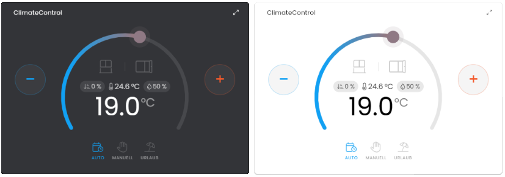

# 🌡️ Klimaregler (Climate Control)

[](https://wilkware.de/module/klimaregler/)
[](https://www.symcon.de/service/dokumentation/entwicklerbereich/sdk-tools/sdk-php/)
[](https://www.symcon.de/produkt/)
[](https://github.com/Wilkware/ClimateControl)
[](https://creativecommons.org/licenses/by-nc-sa/4.0/)
[](https://github.com/Wilkware/ClimateControl/actions)

Visuelle Steuerung von Heizung, Kühlung und Klimaanlagen über ein interaktives, vollständig skalierbares HTML-SDK-Widget.

 

## Inhaltsverzeichnis

1. [Funktionsumfang](#user-content-1-funktionsumfang)
2. [Voraussetzungen](#user-content-2-voraussetzungen)
3. [Installation](#user-content-3-installation)
4. [Einrichtung](#user-content-4-einrichtung)
5. [Statusvariablen](#user-content-5-statusvariablen)
6. [Darstellungen](#user-content-6-darstellungen)
7. [Visualisierung](#user-content-7-visualisierung)
8. [Befehlsreferenz](#user-content-8-befehlsreferenz)
9. [Versionshistorie](#user-content-9-versionshistorie)

### 1. Funktionsumfang

* Interaktive, kreisförmige Temperatur-Anzeige (Gauge) mit Farbverlauf von Kalt- zu Warm-Farbe
* Zieltemperatur per Ziehen des Reglers, Antippen des Bogens oder über separate Plus-/Minus-Tasten einstellbar
* Anzeige der Ist-Temperatur, optional erweiterbar um relative Luftfeuchte und Ventilstellung
* Zwei frei konfigurierbare Status-Icons (z. B. „Fenster offen“, „Prognose“), jeweils an eine eigene Variable gebunden
* Frei konfigurierbare Betriebsmodi (z. B. Urlaub, Programm, Manuell, Pause, Aus) mit eigenem Icon, Name und Farbe je Modus
* Komfortabler Import der verfügbaren Modi direkt aus dem Profil bzw. der Darstellung der Modus-Variable per Knopfdruck
* Vollständig responsives Layout (HTML-SDK/Container Queries) – Gauge, Icons und Beschriftungen skalieren automatisch mit der Kachelgröße
* Automatische Anpassung an Hoch- und Querformat, inklusive Plus-/Minus-Tasten im Querformat
* Automatische Unterstützung von hellem und dunklem Theme

### 2. Voraussetzungen

- Symcon ab Version 8.1

### 3. Installation

* Über den Modul Store das Modul _Klimaregler_ installieren.
* Alternativ über das Modul Control folgende URL hinzufügen.  
`https://github.com/Wilkware/ClimateControl` oder `git://github.com/Wilkware/ClimateControl.git`

### 4. Einrichtung

* Unter 'Instanz hinzufügen' ist das _Klimaregler_-Modul unter dem Hersteller '(Sonstige)' aufgeführt.

__Konfigurationsseite__:

Einstellungsbereich:

> 🌡️ Klimadaten ...

Name                       | Beschreibung
-------------------------- | ---------------------------------
Ist-Temperatur             | Variable, die die aktuelle (Ist-)Temperatur liefert.
Soll-Temperatur            | Variable, die die Ziel-(Soll-)Temperatur liefert bzw. per Gauge gesetzt wird.
Minimale Temperatur        | Untere Grenze der Temperaturskala bzw. der einstellbaren Soll-Temperatur (Standard: 4,5 °C), passend zur eigenen Hardware.
Maximale Temperatur        | Obere Grenze der Temperaturskala bzw. der einstellbaren Soll-Temperatur (Standard: 30,5 °C). Muss größer als die minimale Temperatur sein, sonst geht die Instanz in den Fehlerzustand.
Ventilstellung (optional)  | Optionale Variable für die Position des Heizventils. Bleibt das Feld leer, wird der Wert in der Visualisierung nicht angezeigt.
Luftfeuchte (optional)     | Optionale Variable für die (relative) Luftfeuchte. Bleibt das Feld leer, wird der Wert in der Visualisierung nicht angezeigt.
Status-Icon links / rechts | Liste mit genau zwei Einträgen für die Status-Icons links/rechts in der Gauge (z. B. Fenster, Prognose). Pro Eintrag: Variable, Name, Icon und Farbe. Bleibt die Variable eines Eintrags leer, wird das entsprechende Icon ausgeblendet.
Aktiver Modus               | Variable, die den aktuell aktiven Modus liefert (Wert muss zu einem der Einträge in der Modus-Liste passen).
VARIABLE ANALYSIEREN        | Liest die Assoziationen aus dem Profil bzw. der Darstellung der gewählten Modus-Variable ein und übernimmt sie automatisch in die Modus-Liste. Bereits manuell angepasste Icons/Farben bleiben dabei erhalten.
LISTE LEEREN                | Löscht alle Werte aus der Modus-Liste. Wichtig wenn man eine andere Variable verlinkt, welche mit den vorherigen Einstellungen nicht zusammenpasst.
Verfügbare Modi             | Liste der verfügbaren Betriebsmodi. Name, Icon und Farbe können frei angepasst werden; der zugrundeliegende Wert wird aus dem Profil übernommen.

__Hinweis:__ Bedienungen aus der Kachel (Soll-Temperatur, Modus, Status) werden ausschließlich über die Aktion der verknüpften Variable ausgeführt, damit das Gerät (z. B. der Stellantrieb) auch tatsächlich schaltet. Hat eine Variable keine Aktion (z. B. eine einfache Benutzervariable), wird sie nicht direkt beschrieben. Ist ein Aktions-Script hinterlegt (siehe _Erweiterte Einstellungen_), wird die Anfrage nur an das Script übergeben, das sie dann selbst verarbeiten kann. Ohne Aktion und ohne Script wird der Wert in der Kachel nur angezeigt und die Bedienelemente sind gesperrt.

> ✨ Visualisierung ...

Name                                       | Beschreibung
------------------------------------------ | -----------------------------------
Farbe (KALT)                               | Farbe für das kalte Ende des Temperatur-Farbverlaufs.
Farbe (WARM)                               | Farbe für das warme Ende des Temperatur-Farbverlaufs.
Status-Beschriftungen anzeigen?            | Blendet die Beschriftung unter den Status-Icons ein oder aus.
Modus-Beschriftungen anzeigen?             | Blendet die Beschriftung unter den Modus-Icons ein oder aus.

> ⚙️ Erweiterte Einstellungen ...

Name                                       | Beschreibung
------------------------------------------ | -----------------------------------
Steuerungsaktivitäten an Script übergeben: | Jede Bedienung in der Kachel (Soll-Temperatur, Modus, Status) wird zusätzlich an das Script übergeben. Hat die verknüpfte Variable eine Aktion, wird diese vorher ausgeführt. Hat sie keine Aktion, übernimmt allein das Script die Verarbeitung.

__Übergebene Parameter__ (in `$_IPS` verfügbar):

Parameter   | Typ          | Wertebereich / Bedeutung
----------- | ------------ | ------------------------------------------------------------
INSTANCE    | int          | ID der Klimaregler-Instanz, von der die Bedienung kommt.
TIMESTAMP   | int          | Zeitpunkt der Bedienung als Unix-Zeitstempel.
TYPE        | string       | Art der Bedienung: `temperature`, `mode` oder `status`.
VARIABLE    | int          | ID der verknüpften Variable: Soll-Temperatur (bei `temperature`), aktiver Modus (bei `mode`) bzw. die Variable des betätigten Status-Icons (bei `status`).
VALUE       | float        | Bei `temperature`: neue Soll-Temperatur in 0,5er-Schritten innerhalb der eingestellten minimalen und maximalen Temperatur.
VALUE       | int / string | Bei `mode`: Wert des gewählten Eintrags aus der Liste _Verfügbare Modi_ (Typ entspricht der Modus-Variable).
VALUE       | bool         | Bei `status`: gewünschter neuer Zustand des Status-Icons (der bisherige Zustand umgekehrt, `true` = ein, `false` = aus).

Zusätzlich stehen die üblichen Systemvariablen eines per `IPS_RunScriptEx` gestarteten Scripts zur Verfügung (`SELF`, `THREAD`, `SENDER` = `RunScript`). Das Script läuft parallel zur Instanz. Um vom Datentyp unabhängig zu sein, sollte `VALUE` im Script passend umgewandelt werden (z. B. `(float)`, `(bool)`).

__Beispiel__ (Inhalt von `$_IPS` bei Betätigung eines Status-Icons):
```php
Array (
    [SELF] => 18056
    [THREAD] => 13
    [SENDER] => RunScript
    [VALUE] => 1
    [VARIABLE] => 12636
    [TYPE] => status
    [TIMESTAMP] => 1783344616
    [INSTANCE] => 47757
)
```

__Beispiel-Script:__
```php
<?php

switch ($_IPS['TYPE']) {
    case 'temperature':
        $temperature = (float) $_IPS['VALUE'];
        // z. B. Soll-Temperatur an mehrere Stellantriebe verteilen
        break;
    case 'mode':
        $mode = $_IPS['VALUE'];
        // z. B. Heizprogramm umschalten
        break;
    case 'status':
        $state = (bool) $_IPS['VALUE'];
        // z. B. Benutzervariable ohne Aktion selbst setzen
        SetValue((int) $_IPS['VARIABLE'], $state);
        break;
}
```

### 5. Statusvariablen

Es werden keine Statusvariablen angelegt.

### 6. Darstellungen

Es werden keine Darstellungen oder Profile benötigt.

### 7. Visualisierung

Man kann das gesamte Modul (HTML-SDK Support) direkt in der Visualisierung verlinken.

### 8. Befehlsreferenz

Das Modul stellt keine direkten Funktionsaufrufe zur Verfügung.

### 9. Versionshistorie

v1.2.20261010

* _NEU_: Minimale und maximale Temperatur der Skala einstellbar (Standard 4,5 °C bis 30,5 °C)
* _NEU_: Bedienung erfolgt ausschließlich über die Aktion der verknüpften Variable bzw. das Aktions-Script, Variablen ohne Aktion werden nicht mehr direkt beschrieben
* _NEU_: Nicht bedienbare Elemente (ohne Aktion und ohne Script) werden in der Kachel gesperrt dargestellt
* _FIX_: Status-Icon aktualisierte sich nicht, wenn nur der rechte Slot belegt war
* _FIX_: Schalten der Status-Icons funktionierte nicht zuverlässig
* _FIX_: Plus-/Minus-Tasten lösten schon beim Überfahren mit der Maus eine Aktion aus
* _FIX_: Benutzerdefinierte Darstellung hat beim Einlesen der Modi jetzt Vorrang
* _FIX_: Abgelehnte Soll-Temperatur wird in der Kachel zurückgesetzt
* _FIX_: Namen mit Sonderzeichen werden in der Kachel korrekt dargestellt
* _FIX_: Fehlgeschlagene Schaltbefehle werden als Warnung gemeldet
* _FIX_: Bibliotheken überarbeitet und Debug-Ausgaben reduziert

v1.1.20260708

* _NEU_: Ventilstellung erlaubt auch boolsche Variable (false = 0%, true = 100%)
* _FIX_: Modusliste kann jetzt auch mit benutzerdefinierten Darstellungen umgehen
* _FIX_: Ratio zwischen Quer- und Hochformat angepasst, Buttons erscheinen jetzt etwas später
* _FIX_: Kit-Icons (fak) werden jetzt auch korrekt angezeigt

v1.0.20260706

* _NEU_: Initialversion

## Entwickler

Seit nunmehr über 10 Jahren fasziniert mich das Thema Haussteuerung. In den letzten Jahren betätige ich mich auch intensiv in der Symcon Community und steuere dort verschiedenste Skripte und Module bei. Ihr findet mich dort unter dem Namen @pitti ;-)

[](https://wilkware.github.io/)

## Spenden

Die Software ist für die nicht kommerzielle Nutzung kostenlos, über eine Spende bei Gefallen des Moduls würde ich mich freuen.

[](https://www.paypal.com/cgi-bin/webscr?cmd=_s-xclick&hosted_button_id=8816166)

## Lizenz

Namensnennung - Nicht-kommerziell - Weitergabe unter gleichen Bedingungen 4.0 International

[](https://creativecommons.org/licenses/by-nc-sa/4.0/)
